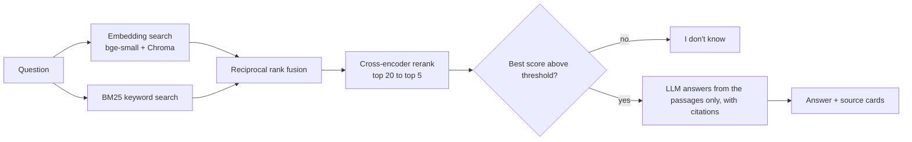

🔗 **[Live Dashboard](https://rag-system-kox4gtbnepmpttc4hyawg7.streamlit.app/)**
# Ask the Hugging Face docs: a RAG system, measured

Question answering over the documentation of `transformers`, `peft`, `datasets`,
`accelerate` and `trl` (474 pages, 3,859 chunks). Answers cite their sources, and the
system says "I don't know" when the docs don't cover a question. It runs on a CPU only,
with free tools throughout.

**Live demo:** SPACE_URL (free tier: it sleeps when idle and takes a minute to wake up)

## How it works



## Results

Two question sets: a **main set** (35 questions, written from the docs) and a **hard set**
(20 questions: exact identifiers and paraphrases with little word overlap). "hit@1" means
the right file was ranked first; the number is how many questions out of the set.

## Retrieval: pipeline stages

| method | main hit@1 | main MRR | hard hit@1 | hard hit@10 | hard MRR | latency (ms) |
|---|---|---|---|---|---|---|
| vector | 29/35 | 0.899 | 10/20 | 19/20 | 0.669 | 21 |
| BM25 | 31/35 | 0.914 | 11/20 | 19/20 | 0.695 | 3 |
| hybrid | 32/35 | 0.933 | 13/20 | 19/20 | 0.766 | 18 |
| vector + rerank | 33/35 | 0.961 | 16/20 | 18/20 | 0.838 | 498 |
| hybrid + rerank | 33/35 | 0.967 | 16/20 | 20/20 | 0.863 | 602 |


### What I found

- **Reranking helped most.** On the hard set, hit@1 went from 10/20 (embeddings alone) to
  16/20 (hybrid + rerank), and MRR from 0.669 to 0.863. On the main set: 29/35 to 33/35.
- **Keyword search and embeddings fail on different questions.** BM25 finds exact
  identifiers like `weight_sync_steps` but can bury paraphrased questions; the reranker
  repairs that.
- **Ablations** (chunk size, headings in the embedded text, MiniLM vs bge-small): with
  hybrid + rerank every variant landed within one or two questions of the baseline.
  Headings in the embedded text helped embedding-only retrieval (about 2 questions
  on both sets). MiniLM embeds about 3x faster.

## Retrieval: ablations (hit@1 questions, MRR in brackets)

| config | vector main | vector hard | hybrid+rerank main | hybrid+rerank hard |
|---|---|---|---|---|
| base | 29/35 (0.899) | 10/20 (0.669) | 33/35 (0.967) | 16/20 (0.863) |
| c100 | 28/35 (0.872) | 11/20 (0.668) | 34/35 (0.977) | 15/20 (0.797) |
| c400 | 28/35 (0.866) | 9/20 (0.603) | 33/35 (0.967) | 15/20 (0.816) |
| nohead | 27/35 (0.843) | 8/20 (0.552) | 33/35 (0.967) | 16/20 (0.871) |
| minilm | 25/35 (0.811) | 11/20 (0.635) | 33/35 (0.967) | 16/20 (0.871) |

### Answer quality


## Generation: prompt v1 vs v2

| | prompt v1 | prompt v2 |
|---|---|---|
| answerable questions run | 55 | 55 |
| wrongly refused | 1 ['h17'] | 0 [] |
| answers with a citation | 48/54 | 53/55 |
| answers citing the gold file | 46/54 | 52/55 |
| unanswerable refused | 19/19 | 19/19 |

Prompt v2 (always cite, answer what the passages cover and say what is missing, never add
claims) fixed one wrongly refused question and cut uncited answers from 6 to 2, while all
19 out-of-scope questions were still refused. I read MANUAL_REVIEW_COUNT answers against
their cited passages: MANUAL_REVIEW_RESULT.

## Limitations

- The question sets are small (one question is 2.9 or 5 points), so differences of one or
  two questions are noise. There are no confidence intervals.
- I wrote the questions with an AI assistant from sampled chunks, so their wording may
  favour lexical overlap, and the baseline chunking may have a home-field advantage.
- Labels are at file level. I audited ambiguous labels after seeing baseline failures
  (the "v2" hard set) and removed two out-of-scope questions after reading the passages
  that answered them. The prompt was also revised after reading failures on the same
  questions, so those gains are in-sample.
- Citation checks only show that an answer cites the right file, not that it is correct;
  that is what the manual review is for.
- One language model (gpt-oss-20b on a free Groq tier). The embedding model was compared
  only against MiniLM; bge-base was not tested. Ablations change one factor at a time.
- Reranking costs about 0.5 s per query on a laptop CPU.

## Run it yourself

```bash
python -m venv .venv && source .venv/bin/activate
pip install -r requirements.txt
python scripts/download_data.py        # downloads the docs
python src/ingest.py && python src/embed.py
source scripts/llm_env.sh              # asks for a Groq API key
streamlit run src/app.py
python src/evaluate.py --run demo --mode hybrid --rerank   # retrieval metrics
python -m pytest -q                    # unit tests
```

## Data and licenses

The index is built from Hugging Face documentation (Apache 2.0); see `corpus/NOTICE.md`.
Code: MIT.
