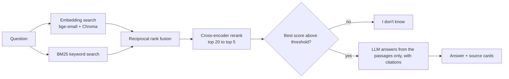

# Ask the Hugging Face docs: a RAG system, measured

Question answering over the documentation of `transformers`, `peft`, `datasets`,
`accelerate` and `trl` (474 pages, 3,859 chunks). Answers cite their sources, and the
system says "I don't know" when the docs don't cover a question. It runs on a CPU only,
with free tools throughout.

**Live demo:** SPACE_URL (free tier: it sleeps when idle and takes a minute to wake up)

## How it works



## Results

Two question sets: a **main set** (35 questions, written from the docs) and a **hard set**
(20 questions: exact identifiers and paraphrases with little word overlap). "hit@1" means
the right file was ranked first; the number is how many questions out of the set.

### Retrieval pipeline

PASTE THE "Retrieval: pipeline stages" TABLE FROM eval/results/RESULTS.md

### What I found

- **Reranking helped most.** On the hard set, hit@1 went from 10/20 (embeddings alone) to
  16/20 (hybrid + rerank), and MRR from 0.669 to 0.863. On the main set: 29/35 to 33/35.
- **Keyword search and embeddings fail on different questions.** BM25 finds exact
  identifiers like `weight_sync_steps` but can bury paraphrased questions; the reranker
  repairs that.
- **Ablations** (chunk size, headings in the embedded text, MiniLM vs bge-small): with
  hybrid + rerank every variant landed within one or two questions of the baseline.
  Headings in the embedded text helped embedding-only retrieval (about 2 questions
  on both sets). MiniLM embeds about 3x faster.

PASTE THE "Retrieval: ablations" TABLE

### Answer quality

PASTE THE "Generation: prompt v1 vs v2" TABLE

Prompt v2 (always cite, answer what the passages cover and say what is missing, never add
claims) fixed one wrongly refused question and cut uncited answers from 6 to 2, while all
19 out-of-scope questions were still refused. I read MANUAL_REVIEW_COUNT answers against
their cited passages: MANUAL_REVIEW_RESULT.

## Limitations

- The question sets are small (one question is 2.9 or 5 points), so differences of one or
  two questions are noise. There are no confidence intervals.
- I wrote the questions with an AI assistant from sampled chunks, so their wording may
  favour lexical overlap, and the baseline chunking may have a home-field advantage.
- Labels are at file level. I audited ambiguous labels after seeing baseline failures
  (the "v2" hard set) and removed two out-of-scope questions after reading the passages
  that answered them. The prompt was also revised after reading failures on the same
  questions, so those gains are in-sample.
- Citation checks only show that an answer cites the right file, not that it is correct;
  that is what the manual review is for.
- One language model (gpt-oss-20b on a free Groq tier). The embedding model was compared
  only against MiniLM; bge-base was not tested. Ablations change one factor at a time.
- Reranking costs about 0.5 s per query on a laptop CPU.

## Run it yourself

```bash
python -m venv .venv && source .venv/bin/activate
pip install -r requirements.txt
python scripts/download_data.py        # downloads the docs
python src/ingest.py && python src/embed.py
source scripts/llm_env.sh              # asks for a Groq API key
streamlit run src/app.py
python src/evaluate.py --run demo --mode hybrid --rerank   # retrieval metrics
python -m pytest -q                    # unit tests
```

## Data and licenses

The index is built from Hugging Face documentation (Apache 2.0); see `corpus/NOTICE.md`.
Code: MIT.